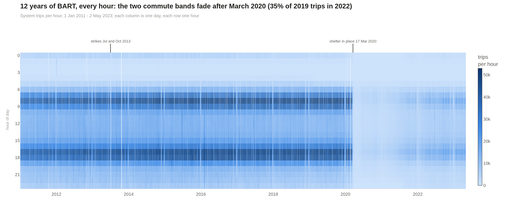
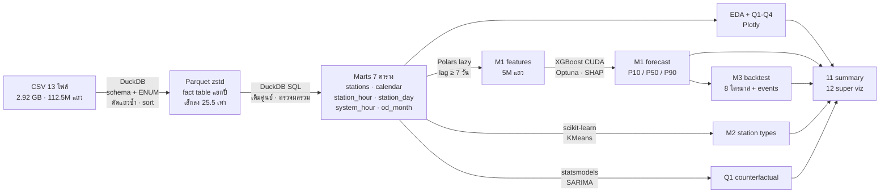
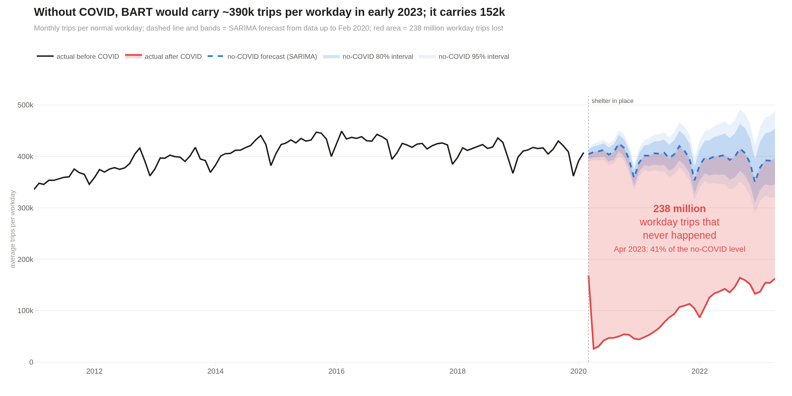
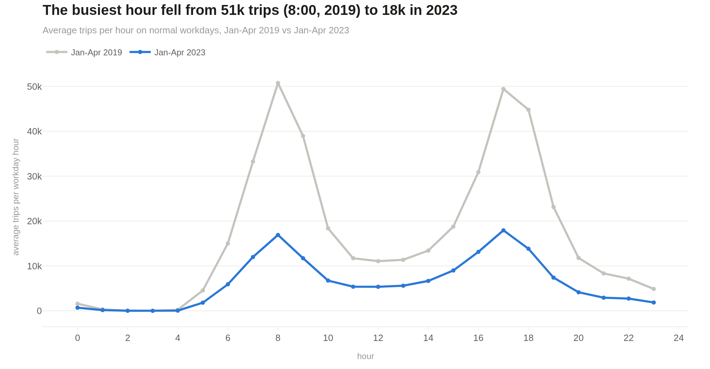
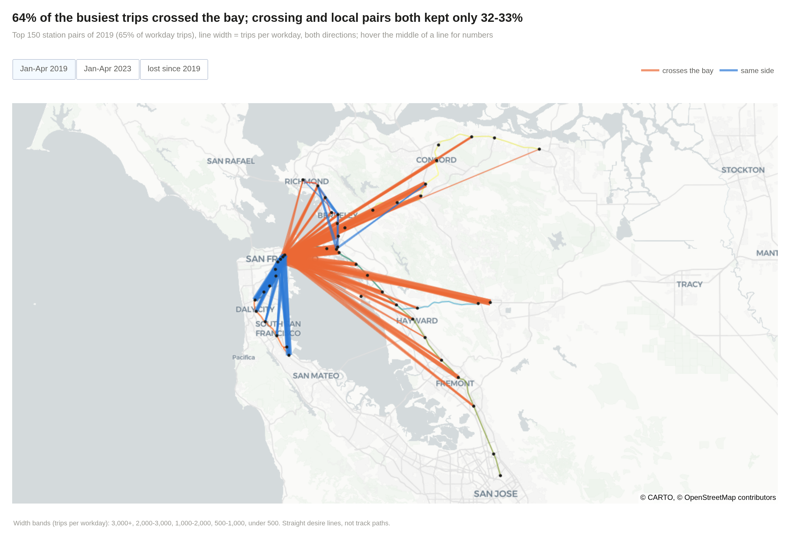
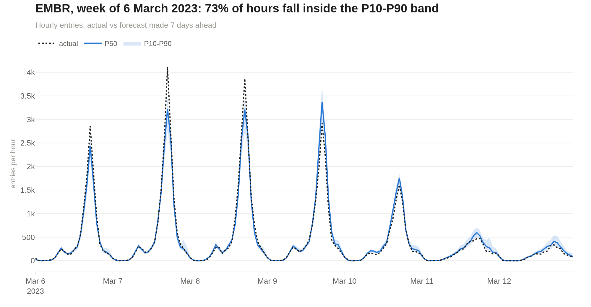
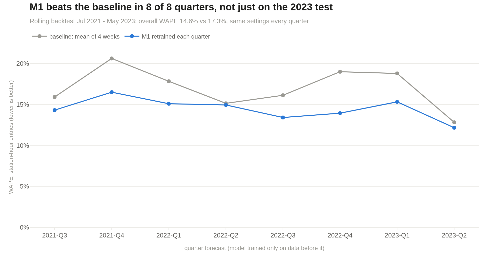
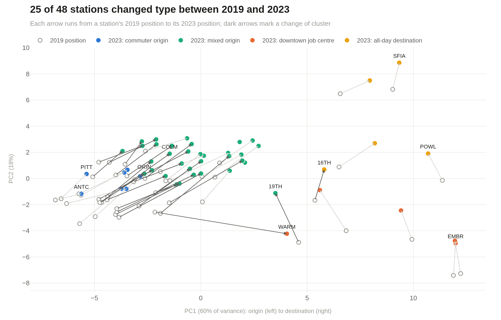
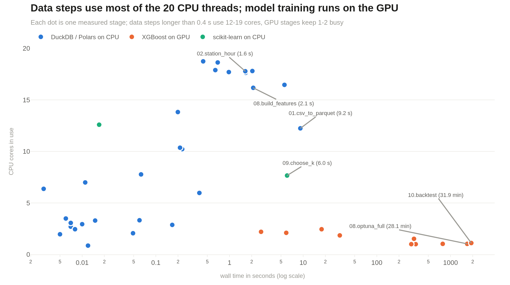

# BART Ridership: 12 ปีของรถไฟฟ้า Bay Area ก่อนและหลัง COVID


โปรเจกต์วิชา Big Data วิเคราะห์ข้อมูลผู้โดยสาร BART (Bay Area Rapid Transit) ระดับ **ต้นทาง × ปลายทาง × ชั่วโมง** ตั้งแต่ ม.ค. 2011 ถึง พ.ค. 2023 รวม **112.5 ล้านแถว, 1,194 ล้านทริป** ประมวลผลทั้งหมดบนโน้ตบุ๊กเครื่องเดียว ไม่ใช้ cluster

งานนี้ตอบคำถามธุรกิจ 4 ข้อให้ฝ่ายวางแผนของ BART และสร้างโมเดล ML 3 ตัว พร้อมเก็บเวลาและทรัพยากรที่ใช้จริงของทุกขั้นตอน



---

## สรุปผลสั้นๆ

| | ผลที่ได้ |
|---|---|
| **Q1 ฟื้นตัวแค่ไหน** | วันทำงานต้นปี 2023 อยู่ที่ **37% ของปี 2019** และนิ่งตั้งแต่ ก.ย. 2022 เทียบกับระดับที่ควรเป็นถ้าไม่มี COVID (SARIMA) ได้ **39%** (ช่วง 95%: 32-48%) ทริปวันทำงานหายไปสะสม **238 ล้านทริป** |
| **Q2 peak เปลี่ยนไหม** | peak แบนลง 9:00 และ 18:00 ฟื้นแค่ 30-31% แต่กลางวันฟื้น 46-50% ชั่วโมงที่คนเยอะที่สุดย้ายจาก 8:00 ไป 17:00 |
| **Q3 โหลดกระจุกที่ไหน** | Transbay Tube ทิศ East Bay → SF ตอน 8:00 ยังหนาแน่นที่สุด แต่เหลือ 32% ของปี 2019 ทิศสวนช่วงเช้าว่างกว่าทิศหลัก 6.9 เท่า |
| **Q4 สถานีใหม่ได้คนใหม่จริงไหม** | ผู้โดยสารใหม่สุทธิเป็นแค่ **1 ใน 4 ถึง 1 ใน 3** ของยอดคนขึ้นที่สถานีใหม่ (eBART 20-24%, Warm Springs 28-35%) ที่เหลือย้ายมาจากสถานีเดิม |
| **M1 พยากรณ์ 7 วัน** | XGBoost บน GPU, WAPE **14.5%** เทียบกับ baseline 17.1% บน test และชนะครบ **8 จาก 8 ไตรมาส** ในการทดสอบย้อนหลัง |
| **M2 บทบาทสถานี** | แบ่งได้ 4 แบบที่เสถียร สถานีต้นทางคนทำงาน 22 จาก 30 แห่งกลายเป็นต้นทางแบบผสมในปี 2023 |
| **M3 backtest + เหตุการณ์** | ช่วง P10-P90 หลังปรับครอบค่าจริง **80.0%** และหาวันพิเศษได้ เช่น พาเหรด Warriors +48%, Pride +80% |

---

## Data pipeline



**ขั้นตอนหลัก**

1. **Ingest** (`01`) อ่าน CSV ด้วย DuckDB โดยกำหนด type เอง (สถานีเป็น ENUM 50 ค่า, trips เป็น USMALLINT) ตัดแถวซ้ำข้ามไฟล์ 16,078 แถว เรียงตามเวลาแล้วเขียน Parquet ทีละปี row group ละประมาณ 1 เดือน query ที่กรองวันที่จึงข้ามข้อมูลที่ไม่เกี่ยวได้
2. **Marts** (`02`) สร้างตารางสรุปที่เติมศูนย์ครบทุกสถานี-ชั่วโมง แต่วันที่ feed ขาดใส่ค่าว่างแทน 0 ติดสถานะวัน (`normal`, `no_data`, `strike`, `partial`) และตรวจว่าผลรวมทริปทุก mart ตรงกับ fact table
3. **Analysis** (`03`-`07`, `13`) EDA และคำถามธุรกิจ อ่านจาก marts ทั้งหมด เทียบ ม.ค.-เม.ย. 2019 กับ ม.ค.-เม.ย. 2023 เพื่อตัดผลของฤดูกาล
4. **Models** (`08`-`10`) features ด้วย Polars, เทรน XGBoost บน GPU ด้วย `QuantileDMatrix`, แบ่ง train / valid / test ตามเวลา และใช้ test ครั้งเดียวตอนจบ
5. **Summary** (`11`, `12`) รวม insight → pain point 26 ข้อ, ข้อเสนอ 8 ข้อ และภาพ interactive 8 ชุด

---

## เครื่องมือ

| เครื่องมือ | ใช้ทำอะไร | ทำไมถึงเลือก |
|---|---|---|
| **DuckDB** | ingest CSV → Parquet, SQL aggregation | vectorized ใช้ได้ทุก thread, ตั้ง memory limit แล้ว spill ลงดิสก์ได้ |
| **Parquet (zstd)** | storage หลัก | อ่านเฉพาะคอลัมน์ที่ใช้ ข้าม row group ด้วย statistics ลด I/O |
| **Polars (lazy)** | feature engineering ของ M1 | query optimizer + window function เร็ว |
| **PyArrow** | ส่งข้อมูลระหว่าง DuckDB, Polars, XGBoost | zero-copy ไม่ต้องคัดลอกซ้ำใน RAM |
| **XGBoost (CUDA)** | M1, M3 | ข้อมูลหลายล้านแถว เทรนหลายรอบ ใช้ GPU คุ้ม |
| **Optuna** | จูน hyper-parameter ของ M1 | TPE ค้นหาทั้ง parameter และช่วงปีของข้อมูลเทรน |
| **SHAP** | อธิบาย M1 | TreeSHAP บน GPU |
| **scikit-learn** | M2 (KMeans) | ข้อมูล 96 ตัวอย่าง CPU เหมาะกว่า GPU |
| **statsmodels** | SARIMA counterfactual | Box-Jenkins ครบขั้นตอน |
| **Plotly** | กราฟทั้งหมด | interactive ใน notebook และเซฟเป็น `.html` + `.png` |
| **psutil** | จับเวลา, RAM, CPU ทุกขั้น | log ลง `outputs/logs/perf.jsonl` |
| **uv** | จัดการ environment | lock เวอร์ชันได้แน่นอน |

**เครื่องที่ใช้:** MSI Katana 15 · Intel i9-13900H (14 คอร์ / 20 เธรด) · RAM 32 GB DDR5-5200 · RTX 4060 Laptop 8 GB · NVMe 1 TB · Ubuntu (รายละเอียดใน [`docs/machine_spec.md`](docs/machine_spec.md))

---

## ผลลัพธ์

### Q1 ถ้าไม่มี COVID ผู้โดยสารควรเป็นเท่าไร

SARIMA(0,1,1)(1,1,0)12 เทรนเฉพาะข้อมูลก่อน COVID แล้วพยากรณ์ช่วง มี.ค. 2020 ถึง เม.ย. 2023 ทุกโมเดลที่ทดสอบให้ผล 37.1-39.6% ข้อสรุปจึงไม่ขึ้นกับการเลือกโมเดล



### Q2 รูปทรงของ peak ในวันทำงาน



### Q3 การเดินทางที่หนาแน่นที่สุด

คู่สถานี 150 คู่ที่คนใช้มากที่สุดในปี 2019 สีส้มคือทริปที่ข้ามอ่าวผ่าน Transbay Tube



### M1 พยากรณ์ล่วงหน้า 7 วัน

ตัวอย่างสถานี Embarcadero หนึ่งสัปดาห์ เส้นน้ำเงินคือ P50 แถบคือช่วง P10-P90



| โมเดล | WAPE | MAE | R² |
|---|---|---|---|
| baseline: สัปดาห์ก่อน | 17.95% | 18.9 | 0.934 |
| baseline: เฉลี่ย 4 สัปดาห์ | 17.12% | 18.1 | 0.940 |
| **M1 (Tweedie)** | **14.50%** | **15.3** | **0.955** |
| **M1 quantile P50** | **14.48%** | **15.3** | **0.958** |

### M3 ทดสอบย้อนหลัง 8 ไตรมาส

แต่ละไตรมาสเทรน M1 ใหม่ด้วยข้อมูลก่อนหน้าเท่านั้น



### M2 สถานีเปลี่ยนบทบาท



### ความเร็ว

ขั้นข้อมูลทั้งหมดรวมกันใช้แค่ราว 32 วินาที เช่น แปลง CSV 2.92 GB เป็น Parquet ใน 7.9 วินาที และสร้าง marts ครบ 7 ตารางใน 4.2 วินาที โดยใช้ CPU จริง 14-18 คอร์ เวลาเกือบทั้งหมดอยู่ที่การเทรน XGBoost บน GPU (จูน 50 trial ~28 นาที, backtest 8 ไตรมาส ~32 นาที) RAM สูงสุด ~11 GB และ VRAM สูงสุด ~4.5 GB



---

## Notebooks

| # | Notebook | เนื้อหา |
|---|---|---|
| 00 | [setup_and_machine](notebooks/00_setup_and_machine.ipynb) | สเปกเครื่อง, ตรวจ GPU |
| 01 | [ingest](notebooks/01_ingest.ipynb) | CSV → Parquet, ตรวจคุณภาพข้อมูล |
| 02 | [marts](notebooks/02_marts.ipynb) | ตารางสรุป 7 ตาราง, calendar |
| 03 | [eda](notebooks/03_eda.ipynb) | EDA: trend, ฤดูกาล, สถานี, OD, autocorrelation |
| 04 | [q1_recovery](notebooks/04_q1_recovery.ipynb) | การฟื้นตัวตามวัน, สถานี, corridor |
| 05 | [q2_peak_shape](notebooks/05_q2_peak_shape.ipynb) | รูปทรงของ peak hour |
| 06 | [q3_load_flows](notebooks/06_q3_load_flows.ipynb) | Transbay Tube, คู่ OD หนาแน่น |
| 07 | [q4_new_stations](notebooks/07_q4_new_stations.ipynb) | eBART, Warm Springs, Silicon Valley |
| 08 | [m1_forecast](notebooks/08_m1_forecast.ipynb) | M1: features, Optuna, quantile, SHAP |
| 09 | [m2_station_typology](notebooks/09_m2_station_typology.ipynb) | M2: KMeans จัดกลุ่มสถานี |
| 10 | [m3_backtest_events](notebooks/10_m3_backtest_events.ipynb) | M3: rolling backtest, ตรวจจับเหตุการณ์ |
| 11 | [summary](notebooks/11_summary.ipynb) | สรุปผล, ข้อเสนอ, เวลาและทรัพยากร |
| 12 | [super_viz](notebooks/12_super_viz.ipynb) | ภาพ interactive 8 ชุด |
| 13 | [q1_counterfactual](notebooks/13_q1_counterfactual.ipynb) | SARIMA counterfactual ของ Q1 |

ภาพ interactive ทั้งหมดอยู่ใน `outputs/super_viz.html` (ดาวน์โหลดแล้วเปิดในเบราว์เซอร์)

---

## โครงสร้างโปรเจกต์

```
BART_RIDERSHIP/
├── data/
│   ├── raw/ridership/     CSV ต้นฉบับ (ไม่อยู่ใน repo)
│   ├── parquet/od/        fact table แยกปี (ไม่อยู่ใน repo)
│   ├── features/          features ของ M1 (ไม่อยู่ใน repo)
│   ├── marts/             ตารางสรุปที่ใช้วิเคราะห์
│   └── reference/         พิกัดสถานีและเส้นทางจาก GTFS
├── docs/                  แผนงาน, สเปกเครื่อง, ผลการจูน M1
├── notebooks/             00-13
├── outputs/
│   ├── figures/           กราฟ .png + .html
│   ├── tables/            ผลของโมเดลและการทดสอบ
│   ├── logs/              perf.jsonl และ log การรัน
│   └── models/            โมเดลที่เทรนแล้ว (ไม่อยู่ใน repo เพราะไฟล์เกิน 100 MB)
├── scripts/               run_all.sh, run_notebooks.py
└── src/bart/              config, perf, stations, periods, viz
```

---

## ข้อจำกัด

- ไม่มีข้อมูลค่าโดยสาร ทุกตัวเลขเป็นจำนวนทริป แปลงเป็นรายได้ไม่ได้
- ไม่มีตารางเดินรถและความจุขบวน ตัวเลขคือความต้องการ ไม่ใช่ความแออัด
- ปี 2023 มีข้อมูลแค่ ม.ค. ถึง 2 พ.ค.
- โมเดลพยากรณ์เฉพาะคนเข้าสถานี (entries)

## แหล่งข้อมูล

- Ridership: [BART Origin-Destination data](http://64.111.127.166/origin-destination/)
- พิกัดสถานีและเส้นทาง: [BART GTFS feed](https://www.bart.gov/dev/schedules/google_transit.zip)
